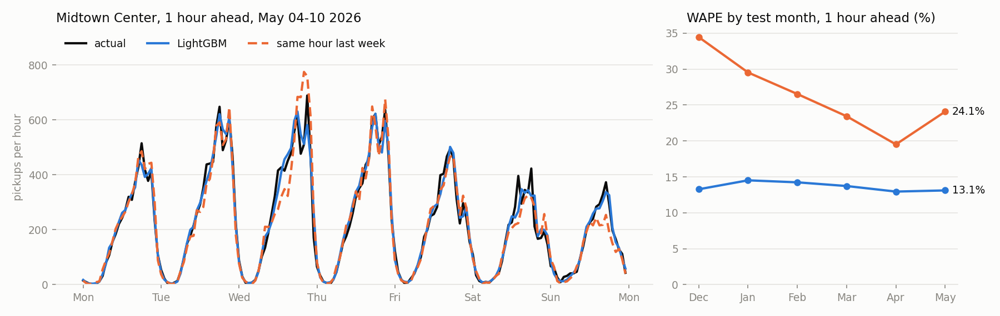
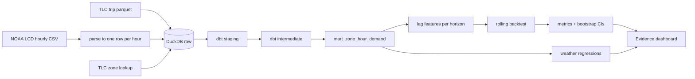

# NYC Taxi Demand Forecasting

[](https://github.com/pratri/nyc-taxi-analytics/actions/workflows/ci.yml)

**[Dashboard](https://nyc-taxi-analytics.vercel.app/)**



Forecasting how many yellow cab pickups each NYC taxi zone will get in the next 1 and 6 hours, using 109M TLC trips (Jan 2024 to May 2026) and hourly weather from the Central Park NOAA station.

This started as a dbt project about where drivers earn the most and whether weather matters. That version used daily weather and found little effect. Hourly weather showed a clear one, so I turned it into a forecasting project to see if weather helps predict demand. (Short answer: it doesn't, see below.)

## Results

Rolling backtest over 6 test months, Dec 2025 to May 2026. 103 zones, about 450k zone-hours per horizon. WAPE is total absolute error divided by total pickups.

| Model | WAPE, 1h ahead | WAPE, 6h ahead |
|---|--:|--:|
| Same hour last week | 26.4% | 26.4% |
| Same hour, last 4 weeks averaged | 23.3% | 23.3% |
| Last hour carried forward | 25.8% | 83.7% |
| LightGBM | **13.6%** | **16.3%** |
| MLP with zone embeddings | 14.4% | 17.4% |
| GRU over last 24h | 14.3% | 17.6% |

LightGBM cuts the error of the seasonal baselines by 30 to 50%. The neural nets come close but are worse at both horizons, and the 95% intervals from resampling days don't cross zero (`artifacts/model_comparisons.csv`). The MLP and GRU get rain and snow as inputs, which made no difference for LightGBM (below). They also took about 2x (MLP) and 10x (GRU) longer to train on CPU, though those timings are rough since runs shared the machine.

Where it struggles, 1 hour ahead: holidays (17.8% vs 13.5% on normal days), hours with at least 1mm of rain (17.9%), and zones in Brooklyn and the Bronx (35% and 46%), which are mostly low volume, so a few pickups either way is a big percentage.

### Uncertainty

The models predict a Poisson mean, so an 80% interval comes for free. It's too narrow: actual pickups land inside it 83% of the time for low-volume zones but only 63% for the busiest third (1h ahead), and 57% at 6h. Busy zones swing more than a Poisson count would, so real intervals would need something like quantile regression or a negative binomial.

### Weather

Rain lines up with big swings in pickups hour to hour. Poisson regression with hour-of-week and month fixed effects, standard errors clustered by day:

| | Light rain (≤1mm/h) | Heavy rain (>4mm/h) | Snow |
|---|--:|--:|--:|
| Manhattan core | +6.5% [4.9, 8.2] | +16.3% [8.8, 24.3] | -15.4% [-26.3, -2.9] |
| Outer boroughs | +5.5% [3.1, 8.0] | +17.7% [6.4, 30.1] | -17.3% [-31.0, -0.8] |
| Airports | -1.0% [-2.9, 0.9] | -10.5% [-17.0, -3.5] | -28.4% [-37.3, -18.3] |

A similar model on daily totals (day-of-week and month effects) loses most of this: only 2 of the 9 rain terms stay significant. Rain comes in short bursts and a daily total washes them out, which is what the first version missed. (The daily model also has 882 rows instead of 21k, so some of that is just less data.)

But weather features didn't help the forecasts:

| LightGBM variant | 1h | 6h |
|---|--:|--:|
| No weather | 13.6% | 16.3% |
| Rain and snow only | 13.6% | 16.4% |
| Rain, snow, temperature, wind | 13.8% | 17.4% |
| Actual weather at the target hour (perfect forecast) | 13.8% | 16.9% |

At 1 hour ahead the model already sees the rain through the last hour's pickups. Rain-only features made no difference. Adding temperature and wind made it worse at both horizons and in all 6 test months at 6 hours, even with perfect weather, which I think is because temperature ends up standing in for time of year and two winters of data isn't enough to learn that properly. So the final model uses no weather at all.

## How it works



- `taxi/ingest.py` downloads everything and parses NOAA's hourly reports.
- `dbt/` cleans trips and builds `mart_zone_hour_demand`: every modeled zone for every hour, zero-filled, with weather and holidays.
- `taxi/features.py` builds lag features for a given horizon.
- `taxi/models/` has the baselines, LightGBM, and the PyTorch MLP/GRU.
- `taxi/backtest.py` trains and scores each test month, then pools the results.
- `taxi/weather_effect.py` runs the regressions, `taxi/export.py` writes the dashboard tables.

## Design notes

### Rolling backtest, no random splits

For each test month, models early-stop on the 4 weeks right before it, then refit on everything up to the month and predict all of it. A random split would let the model train on the hour after the one it's predicting.

### Features only look backward

A 6-hour-ahead forecast for 3pm can only use data up to 9am. `tests/test_features.py` checks this by scrambling everything after the forecast time and asserting the features don't change. When I shifted one of the features by an hour on purpose, the test caught it.

### Poisson loss

Pickups are counts and busy zones swing more than quiet ones, so LightGBM uses the Poisson objective and the neural nets use Poisson NLL. The neural nets add log(4-week average for that hour of week) as an offset, so they learn a correction to the weekly pattern instead of each zone's scale from scratch.

### Zones are picked from 2024 only

A zone is modeled if it averaged at least 1 pickup an hour in 2024, before any test month. That's 103 zones and 99% of pickups.

### Daylight saving

TLC timestamps are local clock time. The spring-forward 2am doesn't exist, so it shows up as zero trips everywhere, and the fall-back 1am has two hours of trips. Those hours are flagged in dbt and left out of training and scoring.

### Weather source

NOAA's old LCD API stops in August 2025, so this uses the v2 yearly files, which are metric and in local time. Only routine hourly reports are used, since the special reports repeat the running precipitation total. There's one 3-day outage (Aug 30 to Sep 2, 2025). Temperature and wind are filled with that hour's average over the surrounding two weeks, and rain is set to 0 for those days since there's no way to know.

### No incremental loading

The trips table used to be incremental. TLC re-publishes whole months, and a corrected trip gets a new hash, so old rows stuck around. A full dbt build of all 109M trips takes about a minute on DuckDB, so it's just a table now.

## Data checks

The dbt tests include:

- panel pickups match a count straight off the raw table with the cleaning rules written out again
- dropoffs reconcile the same way
- the panel is exactly zones x hours
- only real DST hours get flagged

pytest covers the feature leakage check, the GRU's history window, NOAA parsing (trace amounts, special reports, the duplicated fall-back hour), and the metrics.

CI builds everything on a committed 3% sample (trips touching 12 busy zones, Sept to Nov 2025) and fails if LightGBM doesn't beat the three baselines on it. It's only a smoke test since there are a few weeks of training data.

## Limitations

- These are completed pickups, not demand. When it rains and every cab is full, the data can't show the people who didn't get one. Uber and Lyft aren't included.
- The weather choice and the learning rate change were first made while looking at the reported test months. I rechecked them afterwards on Oct and Nov 2025 with the rule written down before running (`taxi/tune.py`: 5 LightGBM settings, then 3 weather options, lowest pooled WAPE wins, keep the current setup if it's within 0.1 points). The current setup and no weather held up (`artifacts/tune/`). A learning rate of 0.05 came out 0.07 points better and hit the 6000 round cap in two of its four runs, so it might do a bit better with more rounds. The options themselves were still picked after seeing test results, so this narrows the problem more than it removes it. LightGBM beat both neural nets in all 6 test months at both horizons, so the model choice wasn't rechecked.
- One seed per model and hyperparameters set by hand, not tuned (the one change: LightGBM's learning rate went from 0.05 to 0.1 after it kept hitting the round cap). The LightGBM vs neural net gap is outside the bootstrap interval, but different seeds or tuning could narrow it.
- TLC publishes data a couple of months late, so this couldn't run live as is.
- One weather station for the whole city, including the airports.
- The "where to go next" table on the dashboard is a rough heuristic (forecast pickups per cab that dropped off there the hour before). There are no driver IDs, so actual wait times aren't known.
- Only credit card tips are recorded, so fares in cash-heavy zones look lower.

## Running it

Needs Python 3.9+ and about 15GB of disk for the full data (2GB raw, the rest is DuckDB).

```bash
python -m venv .venv
source .venv/bin/activate    # .venv\Scripts\activate on Windows
pip install torch==2.8.0 --index-url https://download.pytorch.org/whl/cpu
pip install -r requirements.txt

python -m taxi sample       # everything on the committed sample, ~20 seconds
python -m pytest tests
```

Full run:

```bash
python -m taxi download     # 29 months of trips + weather
python -m taxi load         # parse weather, load raw tables
python -m taxi build        # dbt deps + build + tests
python -m taxi backtest     # slow: hours of training, mostly the GRU
python -m taxi report       # pool runs, metrics, bootstrap intervals
python -m taxi tune         # optional: recheck LightGBM settings on Oct-Nov 2025, ~1h
python -m taxi weather
python -m taxi export       # tables for the dashboard
cd reports && npm install && npm run sources && npm run dev
```

The backtest can be split across processes with `--folds`, e.g. `python -m taxi backtest --folds 2025-12 2026-01`. `--models` reruns just some models; each run is saved under its own name, and `report` uses the newest run for each model and month.

## Sources

- [NYC TLC Trip Record Data](https://www.nyc.gov/site/tlc/about/tlc-trip-record-data.page), yellow taxi, 2024-01 to 2026-05
- [NOAA Local Climatological Data v2](https://www.ncei.noaa.gov/products/land-based-station/local-climatological-data), Central Park (USW00094728)
