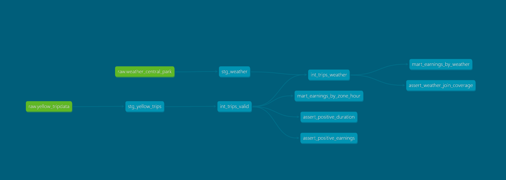

# NYC Taxi Driver Earnings: Where, When, and Does Weather Matter?

An analytics engineering project that answers a concrete question: **where and when should a NYC yellow taxi driver position to maximize earnings per hour, and how much does weather move that?**

It ingests ~48M NYC TLC yellow taxi trips, joins them to Central Park daily weather, and transforms the raw data through a layered, tested dbt pipeline into analysis-ready marts, served through an interactive dashboard. The same dbt project runs on both a local DuckDB engine and Google BigQuery.

## The Question

Drivers decide where to sit and when to drive. This project turns two public datasets into an answer: earnings per hour broken down by pickup zone and time of day, plus how that shifts with weather conditions.

## Architecture

Raw data lands untouched, then flows through staging (rename/type), intermediate (business logic), and marts (analysis-ready aggregates):

```
NYC TLC parquet ─┐
                 ├─► raw ─► staging ─► intermediate ─► marts ─► dashboard
NOAA weather CSV ┘
```



- **staging** — thin models, one per source. Rename columns, cast types, nothing else. Materialized as views.
- **intermediate** — defines a *valid revenue trip* and computes *driver earnings*; joins weather. Materialized as views.
- **marts** — earnings per hour by zone/hour, and earnings by weather condition. Materialized as tables.

## Stack and Why

- **DuckDB** — local, free, reads parquet natively with no load step, fast columnar aggregation on a laptop. The right tool for single-developer analytical work at this scale.
- **dbt (dbt-duckdb / dbt-bigquery)** — layered transforms with version control, tests, docs, and an auto-generated lineage DAG.
- **BigQuery (sandbox)** — the project is built warehouse-portable; switching targets is a config change, not a rewrite. Proven by actually running the identical models on BigQuery's free sandbox.
- **Evidence.dev** — git-based dashboard that reads straight from DuckDB.

DuckDB was chosen deliberately over starting on a cloud warehouse: zero infrastructure, zero billing risk, and faster iteration. The models were structured to be portable, and that portability was then demonstrated on BigQuery rather than just claimed.

## Key Findings

**Airport zones dominate earnings per hour.** JFK (zone 132) and LaGuardia (zone 138) top the earnings-per-hour rankings, consistent with long, high-value airport runs.

**Weather shows a modest, suggestive association.** In the data analyzed, snowy and lightly rainy days showed somewhat higher earnings per *in-trip hour* than dry days.

## Limitations (read this part)

This project is built to be honest about what it can and cannot claim:

- **Earnings per hour uses in-trip time, not shift time.** It measures dollars per hour with a passenger, not per hour on shift including waiting and deadheading. This inflates rates for low-frequency, high-value slots like airport pickups at 4am. The weather "bump" is driven partly by *shorter trip durations* on those days, not higher per-trip earnings — the per-trip averages actually move the opposite way.
- **Driver earnings ≠ total fare.** `driver_earnings = fare_amount + tip_amount + extra`, deliberately excluding taxes, tolls, and government surcharges (MTA tax, congestion fees, airport fees) that the driver does not keep. Using `total_amount` would have ranked zones partly by tax/toll throughput.
- **Cash tips are unobserved.** TLC records only credit-card tips, so earnings systematically undercount cash-tipped trips, biasing cash-heavy zones downward.
- **Weather sample is limited.** Conclusions about weather rest on a limited number of weather-distinct days and are confounded with calendar effects (e.g. New Year's Day fell on a snowy day). The direction is suggestive, not causal.
- **BigQuery run is a subset.** To stay within the free sandbox's 10 GB storage limit and its lack of DML support, the BigQuery deployment uses one month of data and materializes the staging model as a table rather than incremental.

## Data Engineering Highlights

- **No natural primary key.** The TLC source has no unique identifier. A surrogate key is generated by hashing trip attributes (`dbt_utils.generate_surrogate_key`).
- **The key surfaced real duplicates.** A `unique` test on the surrogate key failed, revealing both near-identical distinct trips (resolved by widening the key) and genuine duplicate records (resolved by `row_number()` deduplication). The dedup makes the incremental model's `unique_key` trustworthy.
- **Incremental loading.** Staging is incremental on DuckDB (processing only new pickup timestamps), with a documented limitation around late-arriving data.
- **Enforced data quality.** Singular tests assert positive trip duration and positive earnings, encoding the cleaning rules as checks rather than hopes.
- **Real warehouse portability.** Porting to BigQuery surfaced genuine SQL dialect differences — `EXCLUDE` vs `EXCEPT`, `date_diff` argument order, `dow` vs `dayofweek` — handled via dbt's cross-database macros (`dbt.datediff`) and target conditionals.

## Running It

```bash
# environment
python -m venv .venv && source .venv/bin/activate    # Windows: .venv\Scripts\Activate.ps1
pip install duckdb dbt-duckdb requests google-cloud-bigquery

# data
python scripts/download.py            # taxi parquet
python scripts/download_weather.py    # NOAA weather
python scripts/load_raw.py            # land into DuckDB
python scripts/load_weather.py

# build + test
dbt deps
dbt build        # runs all models and tests against DuckDB

# dashboard
cd reports && npm install && npm run sources && npm run dev

# optional: BigQuery
dbt build --target bigquery
```

## Data Sources

- NYC TLC Trip Record Data (yellow taxi, parquet)
- NOAA NCEI Daily Summaries, Central Park station (USW00094728)
